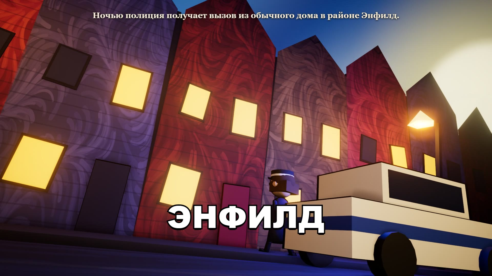
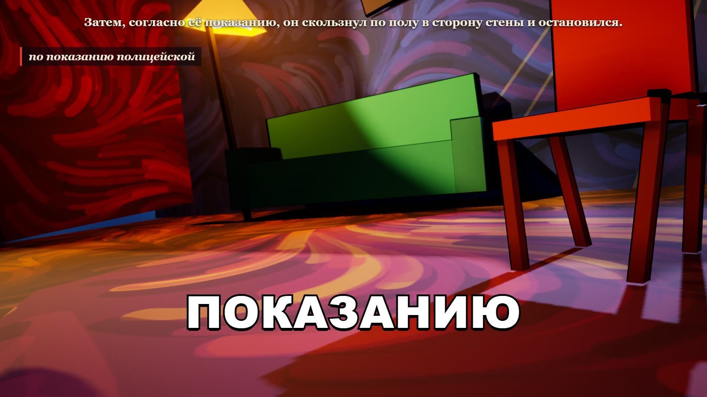
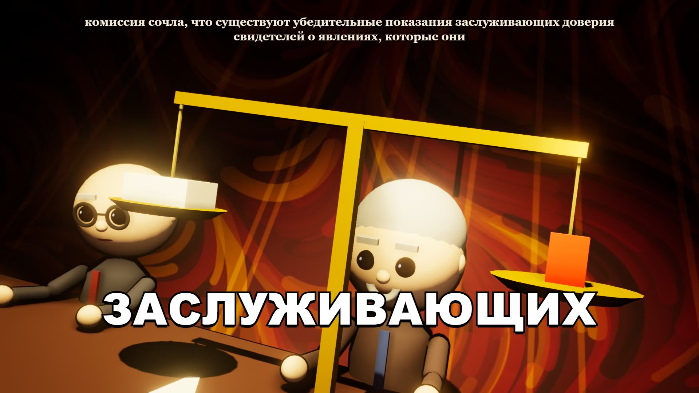
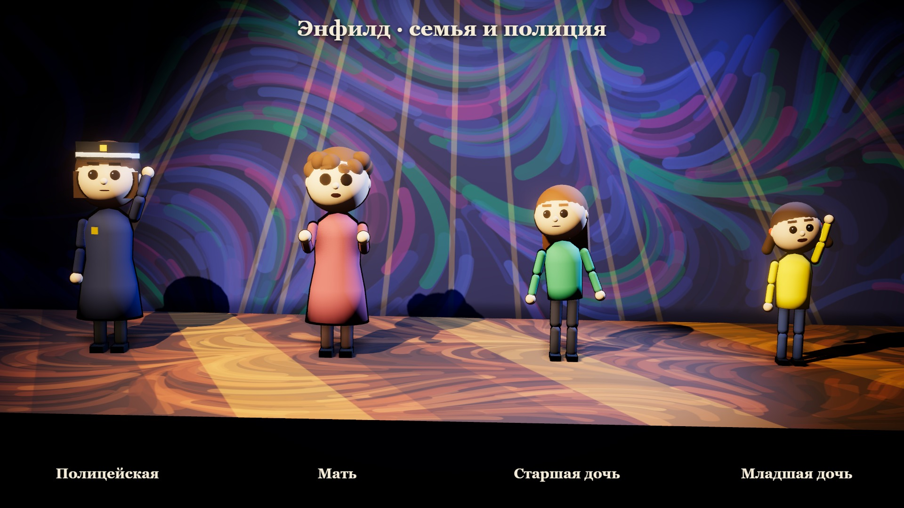

# Expressionist 3D

Анимация в браузере в экспрессионистском стиле: кривые декорации в духе «Кабинета доктора Калигари», стены, расписанные вихревыми мазками как у Ван Гога, резкий театральный свет и длинные тени, мультяшные герои, камера в постоянном движении. Всё рисуется кодом на [three.js](https://threejs.org) и рендерится в видео через headless Chrome и ffmpeg.

*Expressionist 3D animation in the browser — crooked Caligari sets, Van Gogh swirl brushwork, hard theatrical light, cartoon characters and a constantly moving camera, rendered to video with headless Chrome + ffmpeg.*





## Что внутри

| Путь | Что это |
|---|---|
| `src/lib.js` | Живописные текстуры (поток мазков + зигзаги, лучи и нарисованные тени), кривые стены из полигонов, обводка, примитивы, сглаживание |
| `src/chars.js` | Мультяшные персонажи: большая голова, глаза-точки, брови и рот для мимики, руки-рукавички, причёски, шляпы, очки, усы. Позы, ходьба, моргание |
| `src/post.js` | Постобработка: AO, глубина резкости, bloom, виньетка (из Lemo-Opuscar, MIT) |
| `examples/room-test` | 16-секундная сцена: комната, стуки, полицейская, скользящий стул |
| `examples/enfield` | Полный 14-минутный фильм «Энфилд»: 9 декораций, 18 персонажей, ~300 кадров монтажа по таймингам озвучки, субтитры по одному слову, режим 9:16 для шортсов |
| `tools/render.mjs` | Рендер страницы в mp4 или в стоп-кадры |



## Запуск

Нужны Node.js 18+, Google Chrome и ffmpeg.

```bash
npm install
npm run demo            # out/room-test.mp4
npm run cast            # стоп-кадр с героями
npm run enfield:short   # первые 40 секунд «Энфилда» вертикально
```

Если Chrome стоит не в стандартном месте — `CHROME_PATH=/путь/к/chrome`, ffmpeg не в PATH — `FFMPEG=/путь/к/ffmpeg`.

Посмотреть сцену вживую: запусти любой статический сервер в корне репозитория (например `npx http-server .`) и открой `examples/enfield/index.html`.

### Параметры рендера

```bash
node tools/render.mjs <папка-сцены> [--fps 24] [--size 1920x1080] [--q "vert=1&clip=0:40"]
                      [--from 0] [--to 60] [--audio звук.wav] [--out out/film.mp4] [--still 1,5.5,12]
```

- `--q "vert=1"` — вертикальный кадр 9:16 (используй с `--size 1080x1920`);
- `--q "clip=a:b"` — рендер только отрезка с a по b секунд;
- `--audio` — подложить готовую звуковую дорожку;
- `--still` — сохранить отдельные кадры вместо видео.

Каждые 1200 кадров страница перезапускается (`--restart`), чтобы память WebGL не росла на длинных фильмах.

## Как сделать свою историю

1. Озвучь текст и получи пословные тайминги (любой распознаватель с временем слов). Сложи их в `data.js` в формате `WORDS = [[слово, начало, конец], …]` и `SEGS = [[начало, конец, ключ], …]` — по ним идут субтитры и монтаж.
2. Опиши декорации в `sets.js`: каждая — функция, возвращающая `{ g: THREE.Group, p: {пропсы} }`. Текстуры — `swirlTex(ширина, высота, фон, [цвета мазков], seed, (ctx) => { нарисованные тени и зигзаги })`.
3. Добавь героев в `CAST` (`src/chars.js`) — цвета одежды, причёска, шляпа, очки, усы.
4. Распиши сцены в `film.js`: `B('ключ-фразы', 'декорация', ['камера1', 'камера2'], (lt, d, t) => { place(...); walk(...); })`. Каждая сцена сама режется на кадры по 2–3,5 секунды с движением камеры и голландским углом.
5. Отрендери: `node tools/render.mjs examples/<история> --audio mix.wav --out out/история.mp4`.

## Лицензия

Код — MIT (см. `LICENSE`). `src/post.js` — MIT, © Lemomo (LemoLab), см. `THIRD_PARTY.md`. Озвучка, музыка и звуковые эффекты опубликованных фильмов в репозиторий не входят.
